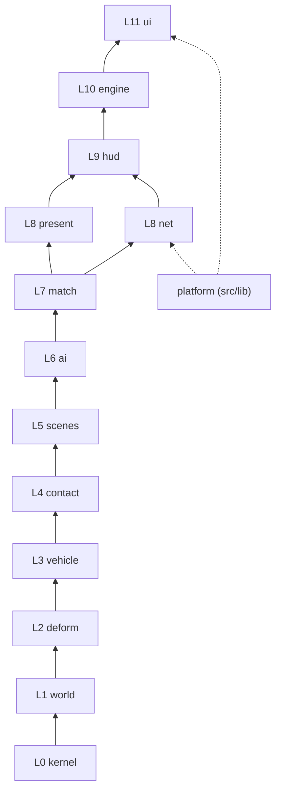

# Architecture and structural rules

How `src/` is cut into bounded contexts, which way dependencies may point, how a frame runs, and the rules that keep the
structure honest as the game grows. The game is meant to be *correctly wobbly*: these rules govern structure, layering,
ownership and test correctness. They never pin a physics number, a feel, or an experiment (section 7).

Every rule that can be counted has a check in `scripts/check-boundaries.mjs`. A check prints a count; **a non-zero count is a
defect to fix, never a baseline to allow.** Until a check reaches 0 it is held by a ratchet: `scripts/boundary-caps.json` caps
every count at its value when the cap was set, `npm run check:boundaries` fails when a count rises above its cap, and the commit
that lowers a count lowers its cap. C8 (size) is report-only.

```
node scripts/check-boundaries.mjs            # one count per check, exit 1 if any is non-zero
node scripts/check-boundaries.mjs --list     # every violation as file:line
npm run check:boundaries                     # ratchet: exit 1 only if a count rises above scripts/boundary-caps.json
node scripts/dup-scan.mjs [--renamed]        # clone report on stdout
```

## 1. Bounded contexts and the layer DAG

Each context is one folder, `src/game/<context>/`. A production file may import its own context or a context on a
**strictly lower** layer. Type-only imports count: they couple the same way. `platform` (`src/lib`) is reachable only from
`net` and `ui`.



(Arrows point from the lower layer up to the layers allowed to use it.)

| L | context | owns | main entry points |
|---|---|---|---|
| 0 | **kernel** | number-only hot kernels and rig tables: `physics-core.js`, `shape-match-core.js` (typed by `.d.ts`), `rig-spec.ts`, `rapier.ts` (the one Rapier loader) | `CRASH`, `crushStroke`, `CAGES`, `MASS_SPECS`, `loadRapier` |
| 1 | **world** | ground, surfaces, track data and courses (`world/tracks/*.json`) | `Ground`, `activeGround`, `setGround`, `SURFACES`, `Track`, `placeProps` |
| 2 | **deform** | masses, clusters, cages, skin, load crush, the WASM skin kernel | `StreamedDeformation` (layers `deform-rig` → `deform-hit` → `deform-state` → `deform-contact` → `deform-solve`) |
| 3 | **vehicle** | the car, body styles, classes, parts, glass, lamps, drive and input | `DeformableCar` (layers `car-core` → `car-parts` → `car`), `CLASSES`, `HANDLING`, `applyDrive`, `DriverSeat` |
| 4 | **contact** | car-car, car-wall, car-prop and striker contact | `physicsSlice`, `satCars`, `resolveCarPair`, `partContactPair` |
| 5 | **scenes** | rigs and props that act on cars, one file per rig | `layoutFleet`, `FleetRamps`, `Corkscrew`, `CompactorRig`, `PistonRig`, `DoorRig`, `StackRig`, `RangeRun`, `JerseyBarrier`, `LawnGuard` |
| 6 | **ai** | drivers: derby, race, traffic, police, Survival hunters | `DerbyBrain`, `RaceBrain`, `TrafficBrain`, `PoliceBrain`, `HunterBrain` |
| 7 | **match** | rules, scoring, campaigns, the crash phase machine | `DerbyMatch`, `RaceSession`, `Campaign`, `AutoWatch`, `CrashPhase` |
| 8 | **present** | FX, camera, cinematics, post, marks, world art, ragdolls, audio | `ChaseCamera`, `Cinematics`, `PostFX`, `TrackArt`, `RagdollSystem`, `Witness`, `SceneFade`, `GameAudio` (one AudioContext, the busses, the listener riding the camera) |
| 8 | **net** | replication over WebRTC | `NetPlay`, the codecs, `NetTransport`, `findMatch` |
| 9 | **hud** | the read model the UI renders | `HudStore`, `CrashHudState`, `KNOB_RANGES`, `INITIAL_HUD`, the share URL |
| 10 | **engine** | orchestration and the frame loop | `CrashEngine` (the only public entry), `RaceDirector` |
| 11 | **ui** | React shell and HUD: `src/components/**`, `src/routes/**`, `src/router.tsx` | `crash-lab.tsx` |
| - | **platform** | template server/client helpers: `src/lib/**` | `P2PRoom`, signaling, `qr`, `cn` |

Deploy (`deploy/`, `scripts/` build helpers, `kernels/`, `migrations/`) sits outside `src/` and is not part of the DAG.

## 2. Boundary rules

- **B1.** Every production file under `src/` belongs to exactly one context (its folder). *Check C0.*
- **B2.** Imports follow the DAG: own context or strictly lower layer; `platform` only from `net`/`ui`; production never imports
  a `*.test.ts`, `*.test-util.ts` or `test-support.ts`. A lateral or upward need means a type or function is in the wrong
  context: move it down, do not add an exception. *Check C1.*
- **B3.** No import cycles between production files (value imports). *Check C2.*
- **B4.** Kernels (`*-core.js`) import nothing but another pure kernel core (`./physics-core.js`, which imports nothing) and never name `THREE`. They take numbers and typed arrays. *Check C3.*
- **B5.** Rule and data contexts (`kernel`, `world`, `ai`, `match`, `hud`, `net`) never name a scene-graph class (meshes,
  materials, geometries, lights, textures, cameras, groups). THREE maths types (`Vector3`, `Quaternion`, curves) are fine.
  *Check C4.*
- **B6.** An export exists because another production file imports it. Symbols used only in their own file are not exported;
  API only tests use lives in a `*.test-util.ts` beside the suite. *Check C5.*
- **B7.** No `implements` in `src/game` (tests included): it only re-declares a shape and lets each class re-implement the
  same logic. A family of classes extends one base class that holds what they share (`CopBrain`, `NetTransport`,
  `RigLayer`). *Check C11*, cap 0: no `implements` remains.

## 3. Construction and ownership

- **O1.** `CrashEngine` is the single composition root: it constructs the cars, rigs, directors, `NetPlay`, FX systems and
  camera, and hands each one what it needs. No other production module constructs another context's top-level object
  (tests may build any object directly).
- **O2.** No module-level mutable state. World state hangs off an object the engine owns, so a second engine, a replay or a
  test never inherits it. Module-scope `const` scratch vectors are fine (rule H3), and so is a lazily built constant behind
  `scalar.ts` `once`. *Check C10* (module-level `let`/`var`). The one accepted row is `ground.ts`'s active ground, a
  scene-scoped singleton read from every per-mass loop; one world steps per process, and its writers are the scene reset and
  the race director (O3).
- **O3.** One writer per piece of state: the context that owns a value is the only one that assigns it. Other contexts read it
  through the owner's API.
- **O4.** Whoever creates a GPU resource (geometry, material, texture, render target) disposes it, in the same file. Shared
  resources are marked shared at creation and disposed by their creator; `renderer.info.memory` stays flat across resets and
  scene switches.
- **O5.** Copies of production behaviour are not allowed anywhere, tests included: a test that needs the step, a contact rule
  or a formula imports it (see T1). One job, one implementation.

## 4. Hot path

- **H1.** The per-frame entry points and the per-pair/per-slice queries they call (`HOT` in the script: `tickInner`,
  `fixedStep`, `stepWorld`, `syncPose`, `updateSkin`, `stepStructure`, `physicsSlice`, `resolveCarPair`,
  `applyDrive`, the AI `think`s, `DerbyMatch.step`, …) allocate nothing: no `new`, no `.clone()`, no array or object literal,
  no closure, no `.push`. Results go into caller-owned `out` objects. *Check C6.*
- **H2.** Per-particle, per-vertex and per-hull data live in typed arrays or preallocated objects sized at construction;
  growth happens only on a cold path (spawn, rig change).
- **H3.** Scratch objects are module- or instance-scope `const`s named `_x`, used within one call and never returned.
- **H4.** Inside per-step and per-frame functions: indexed `for` loops, no `try`/`catch`, `arguments`, recursion or
  `for…of`, monomorphic shapes. A hot loop moves into a plain-JS `*-core.js` kernel (typed by a sibling `.d.ts`) only when
  `npm run bench` shows the TypeScript build costing time.

## 5. Tests

- **T1.** Tests drive the production entry points: the engine's own step (`stepWorld`, `engine/world-step.ts`), the phase
  machine (`match/phase.ts`), the real rig, the real contact rule. A harness may assemble a scene but never re-implements
  the loop or a rule.
- **T2.** Fail before you pass: a new behaviour test is seen red once, by breaking the production line it covers.
- **T3.** Assert behaviour the player sees (crush metres, kill speeds, who wins, laps, what a client renders), not wiring,
  forwarding, copies of a constant or source text. Test text reads given / when / then in behaviour terms; cases of the
  same shape are one flat table.
- **T4.** Never deep-compare two computed values (`deepEqual`, `deepStrictEqual`, `notDeep*`): on large float arrays the
  failure diff alone can exhaust memory. Buffers and replays are compared by first mismatch index plus max |diff|
  (`assertSameNumbers`) or by a hash (`assertSameDigest`). *Check C9.*
- **T5.** Deterministic: fixed `dt`, seeded randomness in anything a test measures, no wall-clock reads in the sim. An
  intermittent red is an undiagnosed bug.
- **T6.** Bounded: traces and per-frame captures use ring buffers or fixed caps; every test, probe and sweep runs under a
  memory cap so a runaway dies alone.

Runner: Vitest 5 (`vitest.config.ts`), with Node's own module loader (`experimental.viteModuleRunner: false`: Node runs the TypeScript as is, no Vite transform) and one forked process per test file. Every process imports
`scripts/test-setup.mjs` first: the WASM skin kernel is loaded, so headless engines and cars skin as the browser does, and a failing assert on big values
gets a bounded message (`scripts/assert-guard.mjs`; `docs/TOOLCHAIN.md`, test memory guards). The JS skin it replaces is checked
against it alone, first, by `npm run test:parity` (`deform/skin-kernel.parity.ts`, the `parity` project: no kernel loaded), and the suites stop if that fails.
A test process that writes to stderr fails the run (`scripts/test-reporter.mjs`, which also prints the slowest files). A row that states an open problem is a
`todoRow(name, reason, fn)` (`kernel/todo-row.test-util.ts`): listed with its reason and not run; `npm run test:todos` runs those bodies and reports green or skipped-with-the-failed-assertion, never failing the run. `npm run test:app` runs the game and
multiplayer suites. Each test stages the moment it claims (cars placed at the poses, speeds and states it needs; no full race,
derby or Survival run, no seed sweep hoping the event happens). Long AI-driven runs that watch a whole field for anything going wrong (stuck cars, false ejections)
are `*.ai-long-run.ts` files, run by `npm run test:ai-long-run` and never by the gate; each one that names a failure has a fast targeted test pinning its mechanism. Harnesses: `contact/crash-scenarios.test-util.ts` (headless crash
scenarios at the engine's slices), `scenes/contact-parity.test-util.ts` (striker vs car), `world/race-world.test-util.ts`
(the whole race stack headless), `vehicle/test-support.ts` (`forModes`, `DT`).

## 6. Tuning knobs

- **K1.** A knob is a named value: a row in a data table (`rig-spec.ts`, `vehicle-classes.ts` `CLASSES`, `physics-core.js`
  `CRASH`/`TRANSFER`, `world/catalog.ts` `SURFACES`, `hud-store.ts` `KNOB_RANGES`) or a module `const`. Inline magic numbers in
  sim code are promoted when touched.
- **K2.** Every knob carries a comment saying where the number comes from: a source (paper, standard, real-world figure, doc
  section) or a measurement (test, sweep cell, probe, A/B). "Guessed, feels right" is a valid source while the knob is being
  tuned; it says so. *Check C7.*
- **K3.** Knobs the player can move go through `KNOB_RANGES` with defaults in `INITIAL_HUD`; `knob-defaults.test.ts` pins the
  calibrated defaults.
- **K4.** A sim step or frame rate is written once, in a `constants.ts`, and every other site imports it and writes `1 / QUIET_HZ`:
  `FINE_HZ`, `SLICES_PER_STEP` and `FRAME_HZ` in `kernel/constants.ts` (the quiet step, `QUIET_HZ`, is `FINE_HZ / SLICES_PER_STEP`), or a
  named rate beside the knob it tunes. What follows from a rate (a slice count, a threshold, a label, a phase grid) is computed from
  it in code, never retyped as a second number. Tests and test-utils obey it too. *Check C13.*

## 7. Wobbly allowances (explicitly allowed)

- **W1. Tuning values change freely.** Moving a knob needs its K2 comment updated and the covering suite re-run.
- **W2. Experiment flags.** A named boolean or enum with a documented default may keep two behaviours side by side while an
  A/B runs. Both paths compile and are exercised; the loser is deleted when the A/B decides.
- **W3. Pooled outcome bars.** Game outcomes and pacing over seeded runs may be pooled ("≥ N of M heats have a winner within
  T"). Physics rules (spin ceilings, zips, sinking, penetration, ramp contact) hold on every run.
- **W4. Visual cheats.** Effects, camera and lighting may ignore physics ([`DESIGN_PILLARS.md`](DESIGN_PILLARS.md) 1). The cheat lives in
  `present`, never in a sim context.
- **W5. Table rows look alike.** Repeated rows in data tables are not duplication.
  `src/game/vehicle/car-styles/` is one such table, a car per file: C13 skips a value only those files repeat.

## 8. Size

- **S1.** Production files ≤ 800 lines, functions ≤ 150 lines. *Check C8*, report-only. Tests are not counted. It reports 20 rows. The hot-path solvers
  among them stay whole on purpose: splitting them would cut a hot loop or a kernel paired with its WASM build, and a
  split is judged on measured inlining, not line count (`car-air.ts` `solveRows` and `stepFree`, `cage-mesh.ts` `decimate`,
  `streamed-deform.ts` `skin`, `kernel/shape-match-core.js`, mirrored by the skin kernel). The rest are docketed for a split pass.
  Files over 800 lines: `engine-core`, `engine-input`, `engine-race-field`, `engine-record`, `engine`, `session`, `engine-ragdoll`,
  `car-core`, `car-parts`, `car`, `surfaces`, `shape-match-core.js`. Functions over 150 lines: `streamed-deform` `skin`,
  `world-step` `stepWorld`, `reel-codec` `readClip`, `track-ground` `buildTerrain`, `cage-mesh` `decimate`, `car-air` `solveRows` and `stepFree`,
  `car-drive` `applyDrive`.

## 9. Code map

**Engine.** `CrashEngine` is one class in layers, each extending the one before: `engine-core` (state, car roster, shared
queries) → `engine-warm` (shader warm-up, skin kernel) → `engine-hud` (`emitHud`) → `engine-derby` (derby on / off, its netplay
mirror) → `engine-scenes` (scene picker, fade, reset, derby step) → `engine-rigs` (press, pistons, doors) → `engine-input` (keys, pad, HUD commands, `advance`) → `engine-reel`
(crash highlights) → `engine-share` (the `#` URL) → `engine.ts`. `window.__crush` is the live engine (benches and probes).
A race runs through `RaceDirector` (`engine-race.ts`) over `RaceHudLayer` (`engine-race-hud.ts`: HUD read model, next-course flow, setup menu), `RaceWatch` (`engine-race-watch.ts`) and `RaceField` (`engine-race-field.ts`).

**Frame** (`CrashEngine.tickInner`, wall `dt` ≤ 0.1 s):

```
pollInput → stepSceneFade → fxFrame
if playing:  simDt = wallDt × timeScale × cine.timeWarp
             SimPacer.run: whole fixedSteps of physicsSlice(cars) against an 8 ms budget (sim-pace.ts): 1/80 s, 80 per second,
                          1/240 s while a crush window is open
               fixedStep: race.drive / applyDrive (seat, derby AI, net peers) → stepWorld (1–8 slices, one when quiet; a step in contact
                          is cut at the 1/240 s floor, 3 slices of exactly 1/240 s at 1/80 s; each: integrate, pair + part contact, SAT passes,
                          stepStructure, clips) → ejections → race.step → cinematic trigger
             stepEdge → scheduleSkins (Witness: off-camera cars defer, small ones stride) → updateSkin
             updatePhase → rigs → FX, ragdolls, smoke, trace → stepDerby → seat.step → cine.update
always:      net.frame → PoseBlend.present (bodies, loose parts, attached parts and the crush skin drawn at the frame's time between
             the last two sim states) → race.frame → updateCamera → flushVisibleSkins → paintScratches.frame (wear masks of the
             drawn cars whose stroke list moved) → detail / lamps → audio frame
             (audio on) → cine.render → PoseBlend.restore (the sim's own poses and skin back) → emitHud every 0.05–0.12 s
             The thrown drivers' world (`RagdollRemote` ↔ `ragdoll-worker.ts`, a module Web Worker, race courses only) is posted its
             frame in the `ragdolls` step above and answers a frame or two later; the sim holds a frame (`RagdollSystem.waiting`) until the
             answer it is to hear (panes struck, cars wanted) is in, so that feedback lands at a fixed step. See docs/CINEMATIC.md.
            The sim's torn parts and popped wheels ride each frame to that world too, with their velocity and mass (`recordLoose`,
            `ragdoll-loose.ts`, `LooseProxies`). Near a live dummy, one slower than 1 m/s is a solid box or disk put at its pose with no
            speed of its own, so a dummy can't pass through it. A faster one is swept along its path, and its first touch of a dummy is the
            showcase press (`strikeAt`) at the point it lands, its push the part's momentum over the struck part's mass. A walker it knocks
            down (`knocksDown`, the one law for every striker) goes limp as the press makes him. One way: he never pushes it back.
```

**Epicenter activation** (`deform/epicenter.ts`, `deform/deform-freeze.ts`; Debug panel group Epicenter and the Activation Whole | Epicenter row under Solver, both on `epi.on`; share-URL keys `epi.*`, default on = `epicenter`; `epi.on=0` is `whole`). With `epi.on` a crashed car whose quiet time has reached `epi.relockHold` (0.35 s, the contact window) is *frozen* at the end of the slice: `stepWorld` skips its `stepStructure` and `syncPose` (`DeformFreeze.stepFrozen`: the clock and the rigid velocity field, one pass), `Car.integrateFrozen` runs its rigid step on the centre of mass and inertia cached at the freeze and places its masses from its frame, and `applyDrive` turns the body only. Anything that writes a mass or restarts the contact clock calls `DeformRig.thaw` first (`epi.frozenCheck` asserts none was missed). It is a cost cut, not a model change: the cage is already rigid once the window is over (`rideBody`), so a frozen wreck differs from `whole` by the seat step and clamp relaxation it skips (a few millimetres; `contact/epicenter-equivalence.test.ts` bounds them). A clip records the knobs (`HighlightClip.epicenter`) and a replay runs under them. Phase A (8 scenes, the owner's fleet traces, the piston matrix of five classes x eight pistons) found no radius that leaves a part of the struck car alone, so there is no spatial ring: the epicenter is the whole car, in time.

`Witness` (`present/witness.ts`) is the one "could the camera see this?" test behind every cosmetic skip (skins, sparks,
debris, smoke). It never gates the sim, audio or marks.

**Audio** (`present/game-audio.ts`, one `AudioContext`). `GameAudio.frame` is the only per-frame seam; it runs after the lamps, when
the camera (which carries the three `AudioListener`) has its matrix for the frame, and only with audio on. Engine voices are a
fixed pool built at unlock (6 on a desktop, 3 on a phone, `?voices=N` overrides): `VoicePool` seats the priority car (the reel's
focus car, else the followed one) and then the nearest cars within 70 m (a car that holds a voice keeps it out to 77 m), and a held car is displaced only by one at least 30%
closer once its slot has held it 0.75 s, so slots never swap as ranks cross. A slot that changes car fades out, swaps in its
generator for the new tuning, and fades in; it never cuts. Upstream's C++ never frees a waveguide, so each voice builds one
generator per tuning (class x damage tone, 15 at most) once and keeps it (`kernels/motor/motor-processor.js`; `motor-heap.test.ts`
holds the shared 16 MB wasm heap flat over 20 000 re-tunes); never call `updateParameters` on a live generator. The music bus is the slider (at most 0.6) ducked under the player's engine and a
crash. The soundtrack (`present/music.ts`) is one streaming `<audio>` element fed by the music folder's `manifest.json`
(`present/music-manifest.ts`, zod-validated; [`DEPLOY.md`](DEPLOY.md), "Music"); no manifest means silence. Audio reads cars and never writes them.
Gain staging (`audio-mix.ts`, `motor-tone.ts`): a voice is the generator's three channels summed and scaled by
`MOTOR_OUTPUT_GAIN`, never clipped (the sum swings to +-9, so the scale keeps every class, stage and rev under -6 dBFS and a redline near
-12 dBFS; `motor-level.test.ts` renders the real worklet to prove it). The panner is `inverse`, refDistance 6 (the chase camera's
distance, so the player's car is at unity), rolloff 2. The engine bus is the slider x1 (default 0.25) into the master chain: a 2:1 glue
compressor, a peak limiter and a -1 dBFS ceiling (`MASTER_GLUE`, `MASTER_LIMITER`, `ceilingCurve`); the music bus (slider at most 0.6, default 0.15, x0.5 trim) shares the master.
The crash hit (`IMPACT` in `audio-mix.ts`) is a 65 Hz sine thump under a dark noise band (300 Hz, soft 12 ms attack, 0.5 s decay) on an impact bus at 0.42 (-3 dB from
the old 0.6); the bus also feeds a ~1 s stereo noise-impulse convolver (lowpassed at 1.8 kHz, wet 0.45) into the master, so a hit sits in a room beside the engines and music.
The focus car's tyres (`TyreSound`, `present/tyre-sound.ts`; `TYRE` and the pure `squealLevel`, `squealHz`, `thudGain` in `audio-mix.ts`) run through the engine bus, so the Engines slider, the pause fade and the slow-mo lowpass carry them,
and `GameAudio.frame` hands them the priority car (nothing for any other car). Squeal: one 2 s noise buffer, looped, through a bandpass (Q 3, 1 kHz at a standstill to 2.5 kHz at 40 m/s, wobbled +-70 cents at 6 Hz) and a gain
(at most 0.06, time constant 25 ms, so 95% in 75 ms) set every 1/30 s from `drive.slide` (drift or sideways slip: from 0.3, full at 0.9, gated by ground speed 2-8 m/s), `drive.lock` and `drive.spin` (x0.8 each); none with every wheel off the ground.
Measured muted in a browser (handbrake slide, then a hard stop, sedan, Engines at 0.25): the squeal's RMS sits 5 dB under the engine's in a slide and 10 dB under it braking hard. Thud: a 60 to 35 Hz sine over 0.25 s plus a short 400 Hz lowpassed burst of the same noise, at 0.015 per m/s of
fall (at most 0.2), on each landing. A landing is `LandingWatch` (`present/landing.ts`), which the chase camera's wobble reads too, so the two cannot disagree: four wheels down within 0.3 s of a flight of at least 0.3 s whose fastest fall passed `LANDING.fall` (5 m/s, the camera's "Fall" knob);
the reported fall is that fastest speed, because the touchdown has eaten most of the last frame's (a nose-first landing takes the wheels down over a few frames). Audio imports `landing.ts`, never the camera.
The race menus (setup, pause) carry the Sound, Music and Engines rows, since their modal covers the settings panel; they and the settings panel's Audio section build their controls from the same `audioLevels` (`hud/audio-levels.ts`), so there is one audio on/off setting.
Engine loudness (`engine-law.ts`): a voice's level follows how a real car's audible level moves with load and revs (BMW M5 Active Sound
Design: load is the dominant control). `engineLawDb(rpmFrac, load)` is the target in dB under a redline at full load (which keeps the
voice's -12 dBFS peak at `MOTOR_OUTPUT_GAIN`): 3.3 dB per doubling of rpm, plus the M5's load curve (flat under 0.15, 8 of 22 dB at half
load, the rest at 1) scaled to an 8 dB coast-to-wide-open span, so idle coast sits 18 dB under redline wide open (real cars span ~30 dB; at the default slider that left idle inaudible). The worklet's own
level wanders +-4 dB with rpm and ignores its throttle parameter, so `NATURAL_DB` holds each class's measured RMS on a 9-point rev grid
(`motor-level.test-util.ts` renders it) and `engineLawGain` is law minus natural: the combined output follows the law, and a redline at
full load gets gain 1. `MotorSound.driveVoice` aims each voice's fade gain at `MOTOR_OUTPUT_GAIN x engineLawGain` every tick, with the load
eased by `easeLoad` (0.1 s attack, 0.3 s release time constants); a misfire dip is a share of that level and holds the per-tick level off while it lasts.

**Car geometry** (`vehicle/car-templates.ts`). What a car draws that depends on its style alone (body, lids, doors, bumpers, panes, the light bar) is built once per style, and each car takes a copy (`ownGeometry`) with its own arrays, index, groups, bounds and `userData`: the skin writes positions and normals, `restoreRest` and the panels read the rest. A template is never drawn or uploaded, so it owns no GPU buffer (O4: a car frees its copy); replacing a field of a style after its build (a test swaps `door` or `drawn`) retires its templates, and nested fields are never edited in place. `car-templates.test.ts` pins every copy equal to a fresh build and untouched by the next car's writes.

**Scenes** (`scenes/scene-id.ts` `SCENE_IDS`, one at a time via `setScene`): fleet (default, with the barrier, ramp balls
and jump ramps as props), press, pistons, doors, corkscrew, stack, derby, race, range, survival. A pick fades through the
cel look and black (`SceneFade`); `__crush.fadeScenes = false` skips it for probes. Keys: [`CONTROLS.md`](CONTROLS.md).

**HUD.** `CrashEngine.emitHud` → `HudStore.publish(snapshot)` → `useSyncExternalStore` in `crash-lab.tsx` → `components/hud*.tsx`.
The HUD calls engine setters and `raceCommand(cmd)`; it never touches sim state.

**Kernels.** `kernel/physics-core.js` and `kernel/shape-match-core.js` are plain JS with `.d.ts` types (TypeScript's emit
was several times slower on these loops). `deform/skin-kernel.wasm` is the skin and normals loop and the tyre hold's plan grid and sag pass, built from
`kernels/skin/` by `npm run build:kernel` and committed; the JS skin and the JS hold stay the reference and the fallback. The skin tables' `skinN` byte packs a point's cluster count (low 3 bits) with its lever share (the other 5 bits, in 31sts: `deform-rig.ts` `SKIN_LEVER_REACH`), and the JS skin, the kernel, `skinPoints`, the cage's `skinCage` and the reference skinner in `skin.test.ts` all read both the same way.

**Material registry** (`kernel/material-ids.ts`, no imports). The one integer registry of every distinct material the game draws (and later hears): `MATERIALS` is a table of rows `[name, family, role]`, and `MAT.NAME` is a row's index. Ids are append-only: never reorder a row and never reuse an id, because they are written into geometry (and later into saved data). Ids 0-13 are the legacy 14 shading families (`GENERIC` ... `INTERIOR`), the rows `vehicle/material-class.ts` keeps a tune row for. A fine id's family names the tune row it is shaded with, the one its mesh drew with before it had a fine id (mistags kept on purpose), so tagging a mesh never changes a pixel: the shader maps a vertex's id to its family through `MATERIAL_FAMILY`, and the per-material uniform carries the family. The role (sheet-metal, concrete, dirt, wood, ...) is what a collision or roll sound will read; nothing reads it yet. A vertex id of 0 means "inherit the material's". Ids are stamped at:

- `tagMaterial(material, MAT.X)` in `vehicle/material-class.ts`: one id per material (`userData.materialClass`).
- The per-vertex `materialClass` attribute: the prefab pieces' third element (`prefab-pieces.ts` `painted`), the terrain, marking, wall, deck and tunnel meshers (`track-mesh.ts` `Mesher`, `cellMaterial`), the derby floor and the minigame station surfaces.
- Car parts: `carTone(MAT.X)` in `vehicle/car-tones.ts` (`CAR_TONE`, id to tone), the one place a car part's look is edited. No car vertex attribute.
- `userData.materialIds` on materials whose existing per-vertex codes need ids: the car primer, fitting and glass-tone codes (`PRIMER_MATERIAL`, `car-materials.ts`) and the dummy's fabrics and roles (`FABRIC_MATERIAL`, `ROLE_MATERIAL`).
- `world/catalog.ts`: `SURFACES[*].ribbon`, `.terrain` and `.patch` and `PrefabSpec.material`. Pure data: nothing in physics, contact or replay reads them, so the sim, `REPLAY_VERSION` and `NET_VERSION` are unchanged.
- `SCRATCH_CUT` and `TAKES_SCRATCH` (`kernel/material-ids.ts`): the contact reads a striker's cut to make cosmetic paint strokes (`scrapePair`), and the paint shader draws them only on the materials that take them (`bare-metal.ts`). Physics reads neither; the strokes ride the wreck section and the keyframe, never a sim reading.
- `WINDOW_BAY` (`world/catalog.ts`): the building window texture's rectangles in canvas pixels; `present/prefabs.ts` `makeWindows` paints from it. It is data only so far; the shader does not read it.

Adding a material: append a row (never insert), give it the family it shades with today, and stamp it at one of the sites above. `kernel/material-ids.test.ts` pins unique names, the legacy rows' own-index families and the role set.

## 10. Changing these rules

A rule changes by editing this file and `scripts/check-boundaries.mjs` in the same commit, with the reason in the commit
body. Adding a file to a context, a name to `HOT`, or a context to the DAG is a normal change; adding an exception list is not.
